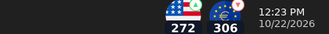
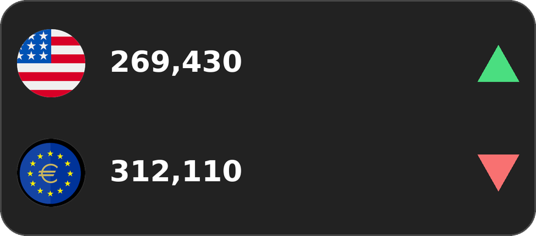

# AW Dollar — نرخ دلار و یورو، واقعاً داخل Taskbar ویندوز

برنامه‌ای سبک برای ویندوز که نرخ دلار و یورو (بازار آزاد) را **مستقیماً داخل نوار وظیفه (Taskbar)**، در همان ناحیه System Tray کنار ساعت/Wi-Fi/بلندگو نشان می‌دهد؛ دقیقاً مثل نمایشگر سرعت اینترنت که فرستادید - یعنی دو تا آیکون واقعی Windows Notification Area، نه یک پنجره شناور جدا روی دسکتاپ.



- 🇺🇸 یک آیکون برای **دلار**: پرچم + قیمت (به هزار تومان، مثلاً «۲۷۲» یعنی ۲۷۲٬۰۰۰ تومان) + یک نشان کوچک روند صعودی/نزولی
- 🇪🇺 یک آیکون برای **یورو**: همان‌طور، با پرچم یورو
- هر **۳۰ دقیقه** خودکار بروزرسانی می‌شوند.
- با نگه‌داشتن ماوس روی هر آیکون (hover)، قیمت دقیق و کامل، کمترین/بیشترین امروز و ساعت آخرین بروزرسانی را به صورت Tooltip می‌بینید (چون فضای یک آیکون Tray برای عدد کامل جا ندارد).
- راست‌کلیک روی هر کدام منو دارد: «به‌روزرسانی الان»، «اجرا هنگام روشن شدن ویندوز»، «مشاهده در مرورگر»، «خروج» و یک گزینه‌ی اضافه: **«نمایش کارت بزرگ قیمت»**.
- «کارت بزرگ قیمت» همان کارت شناور و گرد (با عدد کامل و بدون کوچک‌نمایی) است که قبلاً دیده بودید؛ الان به صورت پیش‌فرض بسته است و فقط وقتی از منو فعالش کنید روی دسکتاپ نمایش داده می‌شود (می‌توانید درگش کنید، موقعیتش ذخیره می‌شود).

> چرا عدد به صورت کامل روی آیکون نیست؟ آیکون‌های ناحیه Notification ویندوز فقط حدود ۱۶ تا ۲۴ پیکسل هستند؛ عدد ۶-۷ رقمی در آن فضا خوانا نمی‌شود، برای همین به هزار تومان گرد می‌شود و عدد دقیق در Tooltip و در «کارت بزرگ قیمت» نشان داده می‌شود.

### کارت بزرگ قیمت (اختیاری)

اگر از منوی راست‌کلیک گزینه «نمایش کارت بزرگ قیمت» را بزنید، همین کارت بزرگ‌تر و با عدد کامل روی دسکتاپ ظاهر می‌شود (قابل درگ‌کردن، موقعیتش ذخیره می‌شود):




## منبع قیمت‌ها

قیمت‌ها از سرویس رایگان و بدون نیاز به کلید (API Key) زیر خوانده می‌شوند:

- `https://api.priceto.day/v1/latest/irr/usd`
- `https://api.priceto.day/v1/latest/irr/euro`

این سرویس ([margani/pricedb](https://github.com/margani/pricedb)) هر ۳۰ دقیقه نرخ بازار آزاد ایران را از tgju.org می‌گیرد و منتشر می‌کند. عدد برگشتی به **ریال** است؛ برنامه آن را بر ۱۰ تقسیم می‌کند تا به **تومان** تبدیل شود.

> اگر در لحظه‌ای اتصال اینترنت قطع باشد یا سرویس پاسخ ندهد، آخرین قیمت دریافت‌شده (stale) همراه با یک نقطه زرد کوچک روی آیکون نمایش داده می‌شود تا بدانید قیمت به‌روز نیست.

## فناوری

- **.NET 8** + **Windows Forms** (`net8.0-windows`)
- بدون هیچ وابستگی NuGet خارجی — فقط از کتابخانه‌های داخلی .NET استفاده شده (`System.Net.Http.Json` برای فراخوانی API، `System.Drawing` برای رسم دینامیک آیکون‌ها و کارت، `Microsoft.Win32.Registry` برای «اجرا هنگام استارت ویندوز» و ذخیره موقعیت کارت).
- دو شیء `NotifyIcon` واقعی (یکی دلار، یکی یورو) که هر بار با قیمت جدید، آیکونشان دوباره رسم می‌شود (`TrayIconRenderer`) - این‌ها همان چیزی هستند که داخل Taskbar می‌بینید.
- یک `Form` بدون کادر و گرد (`PricePanelForm`) برای «کارت بزرگ قیمت» که اختیاری و پیش‌فرض مخفی است.

## ساخت و اجرا (روی ویندوز)

> این پروژه باید روی یک سیستم **ویندوز** با **.NET 8 SDK** نصب‌شده Build شود (Windows Forms فقط روی ویندوز اجرا می‌شود).

### ساده‌ترین راه: فایل‌های `.bat`

۱. [.NET 8 SDK](https://dotnet.microsoft.com/download/dotnet/8.0) را نصب کنید.
۲. روی **`start.bat`** (در ریشه مخزن) دوبار کلیک کنید.

   این فایل خودش بررسی می‌کند .NET نصب است یا نه، برنامه را (در حالت Release) می‌سازد و بلافاصله اجرا می‌کند. بار اول چون باید build شود چند ثانیه طول می‌کشد؛ دفعات بعد که دوباره اجرایش کنید، چون از قبل ساخته شده خیلی سریع‌تر بالا می‌آید. اگر نیاز به rebuild باشد (مثلاً بعد از تغییر کد) خودش دوباره build می‌کند.

۳. اگر می‌خواهید یک فایل `.exe` مستقل بسازید که روی هر ویندوزی حتی بدون نصب .NET اجرا شود، روی **`publish.bat`** دوبار کلیک کنید. خروجی در این مسیر ساخته می‌شود:

   ```
   src\AW_Dollar\bin\Release\net8.0-windows\win-x64\publish\AW_Dollar.exe
   ```

   همین یک فایل `.exe` را می‌توانید روی هر سیستم ویندوزی کپی و اجرا کنید.

### روش دستی (برای توسعه‌دهنده‌ها)

```powershell
cd src\AW_Dollar
dotnet run
```

یا کل Solution را در **Visual Studio 2022** باز کنید (`AW_Dollar.sln`) و Run بزنید.

برای ساخت نسخه مستقل به‌صورت دستی (همان کاری که `publish.bat` انجام می‌دهد):

```powershell
cd src\AW_Dollar
dotnet publish -c Release -r win-x64 --self-contained true -p:PublishSingleFile=true -p:IncludeNativeLibrariesForSelfExtract=true
```

با هر روش، به‌محض اجرا، بلافاصله دو آیکون (دلار و یورو) داخل Taskbar، کنار ساعت، ظاهر می‌شوند.

## ساختار پروژه

```
AW_Dollar.sln
start.bat                    ← دوبار کلیک = build (در صورت نیاز) + اجرا
publish.bat                  ← دوبار کلیک = ساخت یک exe مستقل برای توزیع
dollar.png, eruo.png         ← آیکون‌های پرچم که ارائه دادید (در پروژه هم به صورت Resource جاسازی شده‌اند)
dollar.svg, euro.svg         ← آیکون‌های اولیه (نگه‌داشته شده‌اند، ولی دیگر در UI استفاده نمی‌شوند)
src/AW_Dollar/
  Program.cs                      ← نقطه ورود
  TrayApplicationContext.cs       ← مدیریت دو NotifyIcon (دلار/یورو)، تایمر ۳۰ دقیقه‌ای، منوها
  PricePanelForm.cs               ← «کارت بزرگ قیمت» اختیاری (بدون کادر، گرد، شناور)
  Models/PriceSnapshot.cs         ← مدل قیمت + روند صعودی/نزولی
  Services/PriceApiClient.cs      ← فراخوانی api.priceto.day
  Services/StartupManager.cs      ← ثبت در Run اجرای خودکار ویندوز
  Services/PanelPositionStore.cs  ← ذخیره محل کارت بزرگ روی دسکتاپ در رجیستری
  Rendering/TrayIconRenderer.cs   ← رسم دینامیک آیکون‌های واقعی Tray (پرچم + عدد + روند)
  Rendering/EmbeddedImageLoader.cs ← بارگذاری پرچم‌های جاسازی‌شده
  Resources/usd_flag.png, eur_flag.png ← پرچم‌های دلار/یورو (از dollar.png و eruo.png)
  Resources/app_icon.ico          ← آیکون برنامه (exe)
```

## تنظیمات قابل تغییر

- **فاصله بروزرسانی:** ثابت `RefreshInterval` در `TrayApplicationContext.cs` (پیش‌فرض ۳۰ دقیقه).
- **ظاهر آیکون‌های Tray:** رنگ‌ها، اندازه فونت و چیدمان در `Rendering/TrayIconRenderer.cs`.
- **واحد نمایش روی آیکون:** تابع `AbbreviatePrice` در `TrayIconRenderer.cs` قیمت را به «هزار تومان» گرد می‌کند؛ عدد دقیق کامل همیشه در Tooltip و در «کارت بزرگ قیمت» قابل مشاهده است.
- **ظاهر کارت بزرگ:** در `PricePanelForm.cs`.

## نکته درباره ساخت در این محیط

کد به طور کامل نوشته و بازبینی شده، اما چون این sandbox به SDK ویندوز/​.NET دسترسی ندارد (و فقط Linux است)، امکان `dotnet build` در همین‌جا وجود نداشت. لطفاً پروژه را روی یک ویندوز با .NET 8 SDK باز/اجرا کنید؛ اگر هنگام build خطایی دیدید برایم بفرستید تا سریع رفع کنم.
