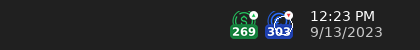
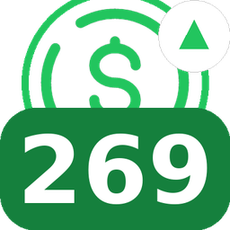
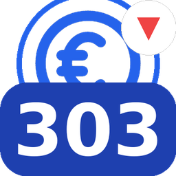

# AW Dollar — نرخ دلار و یورو در Tray ویندوز

برنامه‌ای سبک برای ویندوز که **بدون هیچ پنجره‌ای**، فقط در ناحیه System Tray (کنار ساعت، گوشه پایین راست صفحه) دو آیکون نشان می‌دهد:

- 💵 نرخ **دلار** (بازار آزاد، به تومان)
- 💶 نرخ **یورو** (بازار آزاد، به تومان)

هر آیکون، قیمت فعلی را به صورت عدد (به هزار تومان، مثلاً «۲۶۹» یعنی ۲۶۹٬۰۰۰ تومان) روی آیکون اصلی (dollar.svg / euro.svg) نشان می‌دهد، یک فلش کوچک روند صعودی/نزولی قیمت نسبت به بروزرسانی قبلی دارد، و هر **۳۰ دقیقه** به‌صورت خودکار بروزرسانی می‌شود — دقیقا شبیه نمایشگر سرعت اینترنت در تصویر نمونه‌ای که فرستادید.

پیش‌نمایش ظاهر آیکون‌ها (نمونه، با اعداد فرضی):



| دلار | یورو |
| --- | --- |
|  |  |

با نگه‌داشتن ماوس روی هر آیکون (hover)، جزئیات کامل (قیمت دقیق، کمترین/بیشترین امروز، ساعت آخرین بروزرسانی) به صورت Tooltip نمایش داده می‌شود. راست‌کلیک روی هر آیکون هم منویی برای «به‌روزرسانی الان»، «اجرا هنگام روشن شدن ویندوز»، «مشاهده در مرورگر» و «خروج» دارد.

## منبع قیمت‌ها

قیمت‌ها از سرویس رایگان و بدون نیاز به کلید (API Key) زیر خوانده می‌شوند:

- `https://api.priceto.day/v1/latest/irr/usd`
- `https://api.priceto.day/v1/latest/irr/euro`

این سرویس ([margani/pricedb](https://github.com/margani/pricedb)) هر ۳۰ دقیقه نرخ بازار آزاد ایران را از tgju.org می‌گیرد و منتشر می‌کند. عدد برگشتی به **ریال** است؛ برنامه آن را بر ۱۰ تقسیم می‌کند تا به **تومان** تبدیل شود.

> اگر در لحظه‌ای اتصال اینترنت قطع باشد یا سرویس پاسخ ندهد، آخرین قیمت دریافت‌شده (stale) همراه با یک نشانگر زرد کوچک روی آیکون نمایش داده می‌شود تا بدانید قیمت به‌روز نیست.

## فناوری

- **.NET 8** + **Windows Forms** (`net8.0-windows`)
- بدون هیچ وابستگی NuGet خارجی — فقط از کتابخانه‌های داخلی .NET استفاده شده (`System.Net.Http.Json` برای فراخوانی API، `System.Drawing` برای رسم پویای آیکون‌ها، `Microsoft.Win32.Registry` برای «اجرا هنگام استارت ویندوز»).
- دو شیء `NotifyIcon` (یکی برای دلار، یکی برای یورو) داخل یک `ApplicationContext` بدون فرم اصلی.

## ساخت و اجرا (روی ویندوز)

> این پروژه باید روی یک سیستم **ویندوز** با **.NET 8 SDK** نصب‌شده Build شود (Windows Forms فقط روی ویندوز اجرا می‌شود).

۱. [.NET 8 SDK](https://dotnet.microsoft.com/download/dotnet/8.0) را نصب کنید.

۲. از ریشه مخزن:

```powershell
cd src\AW_Dollar
dotnet run
```

یا کل Solution را در **Visual Studio 2022** باز کنید (`AW_Dollar.sln`) و Run بزنید.

۳. برای ساخت یک فایل اجرایی مستقل (بدون نیاز به نصب .NET روی سیستم مقصد):

```powershell
cd src\AW_Dollar
dotnet publish -c Release -r win-x64 --self-contained true -p:PublishSingleFile=true -p:IncludeNativeLibrariesForSelfExtract=true
```

فایل خروجی در مسیر زیر ساخته می‌شود:

```
src\AW_Dollar\bin\Release\net8.0-windows\win-x64\publish\AW_Dollar.exe
```

همین فایل `.exe` را اجرا کنید؛ بلافاصله دو آیکون در Tray ظاهر می‌شوند (ابتدا با حالت «در حال دریافت قیمت...» و چند ثانیه بعد با قیمت واقعی).

## ساختار پروژه

```
AW_Dollar.sln
dollar.svg, euro.svg        ← آیکون‌های اصلی ارائه‌شده (در Resources هم به صورت PNG جاسازی شده‌اند)
src/AW_Dollar/
  Program.cs                 ← نقطه ورود؛ بدون پنجره اصلی
  TrayApplicationContext.cs  ← مدیریت دو NotifyIcon، تایمر ۳۰ دقیقه‌ای، منوها
  Models/PriceSnapshot.cs    ← مدل قیمت + روند صعودی/نزولی
  Services/PriceApiClient.cs ← فراخوانی api.priceto.day
  Services/StartupManager.cs ← ثبت در Run اجرای خودکار ویندوز
  Rendering/TrayIconFactory.cs ← رسم پویای آیکون (گرافیک + عدد قیمت) با System.Drawing
  Resources/dollar_base.png, euro_base.png ← نسخه رستر شده از dollar.svg / euro.svg (برای رسم در آیکون)
  Resources/app_icon.ico     ← آیکون برنامه (exe)
```

## تنظیمات قابل تغییر

- **فاصله بروزرسانی:** ثابت `RefreshInterval` در `TrayApplicationContext.cs` (پیش‌فرض ۳۰ دقیقه).
- **رنگ/ظاهر آیکون:** داخل `TrayIconFactory.cs` (رنگ دایره، رنگ نوار قیمت، سایز فونت).
- **واحد نمایش روی آیکون:** تابع `AbbreviatePrice` قیمت را به «هزار تومان» گرد می‌کند (مثلا ۲۶۹) چون فضای آیکون در Tray بسیار کوچک است (۱۶ تا ۲۴ پیکسل)؛ عدد دقیق کامل همیشه در Tooltip و منو قابل مشاهده است.

## نکته درباره ساخت در این محیط

کد به طور کامل نوشته و بازبینی شده، اما چون این sandbox به SDK ویندوز/​.NET دسترسی ندارد (و فقط Linux است)، امکان `dotnet build` در همین‌جا وجود نداشت. لطفاً پروژه را روی یک ویندوز با .NET 8 SDK باز/اجرا کنید؛ اگر هنگام build خطایی دیدید برایم بفرستید تا سریع رفع کنم.
