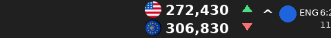

# AW Dollar — نرخ دلار و یورو، چسبیده به خود Taskbar ویندوز

برنامه‌ای سبک برای ویندوز که نرخ دلار و یورو (بازار آزاد) را **مستقیماً روی خود نوار وظیفه (Taskbar)**، درست کنار ناحیه System Tray (قبل از ساعت/Wi-Fi/بلندگو) نشان می‌دهد - دقیقاً مثل ابزارهای نمایش سرعت اینترنت در Taskbar که فرستادید؛ یعنی متن/آیکون مستقیم روی خود نوار، نه یک پنجره جدا روی دسکتاپ.



- 🇺🇸 ردیف اول: پرچم دلار + قیمت کامل (به تومان) + فلش کوچک روند صعودی/نزولی
- 🇪🇺 ردیف دوم: پرچم یورو + قیمت کامل (به تومان) + فلش کوچک روند صعودی/نزولی
- پس‌زمینه‌اش کاملاً شفاف است - دقیقاً روی پیکسل‌های واقعی Taskbar شما نشسته (هر رنگ/تم/شفافیتی که Taskbar‌تان دارد)، نه یک جعبه یا آیکون جدا.
- هر **۳۰ دقیقه** خودکار بروزرسانی می‌شود.
- **اندازه متن و پرچم‌ها دست خود شماست:** یا از منوی راست‌کلیک گزینه «اندازه متن و آیکون روی Taskbar» را باز کنید (کوچک / متوسط / بزرگ / خیلی بزرگ)، یا ساده‌تر، **روی خود نوار قیمت اسکرول کنید** (چرخ وسط ماوس) تا در لحظه بزرگ و کوچک شود. انتخابتان ذخیره می‌شود و دفعه بعد هم همان‌طور باز می‌شود. برنامه همیشه بزرگ‌ترین فونتی را انتخاب می‌کند که بدون بریده‌شدن در همان ارتفاع واقعی Taskbar شما جا شود.
- یک آیکون کوچک هم در System Tray هست که فقط برای دسترسی به منو است: «به‌روزرسانی الان»، «نمایش/مخفی‌کردن کارت بزرگ قیمت»، «اجرا هنگام روشن شدن ویندوز»، «مشاهده در مرورگر»، «خروج». راست‌کلیک روی خود نوار قیمت هم همین منو را باز می‌کند.
- اگر بخواهید عدد را بزرگ‌تر و با جزئیات بیشتر (کمترین/بیشترین روز) ببینید، از منو گزینه «نمایش کارت بزرگ قیمت» را بزنید - همان کارت شناور و گرد قبلی، که قابل درگ کردن است و موقعیتش ذخیره می‌شود.

### این چطور کار می‌کند (و محدودیتش)

ویندوز هیچ API رسمی برای «اضافه کردن یک آیتم به Taskbar» در اختیار برنامه‌های عادی نمی‌گذارد. این برنامه از همان ترفند شناخته‌شده‌ای استفاده می‌کند که ابزارهای نمایش سرعت شبکه در Taskbar (مثل نمونه‌ای که فرستادید) سال‌هاست استفاده می‌کنند: پنجره‌ی خودش را پیدا می‌کند (`Shell_TrayWnd`)، بخش System Tray داخلش را پیدا می‌کند (`TrayNotifyWnd`)، و پنجره‌ی شفاف و بدون‌حاشیه‌ی خودش را به‌عنوان یک **فرزند واقعی** همان پنجره Taskbar می‌چسباند (`SetParent` + تغییر استایل به `WS_CHILD`)، درست قبل از ناحیه System Tray. چون واقعاً فرزند Taskbar می‌شود، با هر حرکت/مخفی‌شدن/جابه‌جایی Taskbar هم جابه‌جا می‌شود.

این روش مستند/رسمی نیست (هیچ ابزار مشابهی مستند نیست)، برای همین:

- اگر به هر دلیلی (مثلاً یک build خاص ویندوز یا سیاست‌های امنیتی سیستم) این اتصال ممکن نشود، برنامه خودش را به حالت جایگزین برمی‌گرداند: همان «کارت بزرگ قیمت» شناور را به‌طور خودکار نشان می‌دهد و یک اعلان (Balloon) هم نشان می‌دهد که این اتفاق افتاده.
- فعلاً فقط Taskbar مانیتور اصلی (Primary) پشتیبانی می‌شود.

## منبع قیمت‌ها

قیمت‌ها از سرویس رایگان و بدون نیاز به کلید (API Key) زیر خوانده می‌شوند:

- `https://api.priceto.day/v1/latest/irr/usd`
- `https://api.priceto.day/v1/latest/irr/euro`

این سرویس ([margani/pricedb](https://github.com/margani/pricedb)) هر ۳۰ دقیقه نرخ بازار آزاد ایران را از tgju.org می‌گیرد و منتشر می‌کند. عدد برگشتی به **ریال** است؛ برنامه آن را بر ۱۰ تقسیم می‌کند تا به **تومان** تبدیل شود.

## فناوری

- **.NET 8** + **Windows Forms** (`net8.0-windows`)
- بدون هیچ وابستگی NuGet خارجی — فقط از کتابخانه‌های داخلی .NET استفاده شده (`System.Net.Http.Json` برای فراخوانی API، `System.Drawing` برای رسم نوار/کارت قیمت، P/Invoke به `user32.dll` برای چسباندن به Taskbar، `Microsoft.Win32.Registry` برای خواندن تم روشن/تاریک، «اجرا هنگام استارت ویندوز» و ذخیره موقعیت کارت بزرگ).
- `TaskbarPriceStrip`: پنجره‌ی شفاف چسبیده به Taskbar (همان چیزی که همیشه می‌بینید).
- `PricePanelForm`: کارت بزرگ اختیاری/جایگزین.
- یک `NotifyIcon` ساده فقط برای منو.

## ساخت و اجرا (روی ویندوز)

> این پروژه باید روی یک سیستم **ویندوز** با **.NET 8 SDK** نصب‌شده Build شود (Windows Forms فقط روی ویندوز اجرا می‌شود).

### ساده‌ترین راه: فایل‌های `.bat`

۱. [.NET 8 SDK](https://dotnet.microsoft.com/download/dotnet/8.0) را نصب کنید.
۲. روی **`start.bat`** (در ریشه مخزن) دوبار کلیک کنید.

   این فایل خودش بررسی می‌کند .NET نصب است یا نه، برنامه را (در حالت Release) می‌سازد و بلافاصله اجرا می‌کند. بار اول چون باید build شود چند ثانیه طول می‌کشد؛ دفعات بعد که دوباره اجرایش کنید، چون از قبل ساخته شده خیلی سریع‌تر بالا می‌آید.

۳. اگر می‌خواهید یک فایل `.exe` مستقل بسازید که روی هر ویندوزی حتی بدون نصب .NET اجرا شود، روی **`publish.bat`** دوبار کلیک کنید. خروجی در این مسیر ساخته می‌شود:

   ```
   src\AW_Dollar\bin\Release\net8.0-windows\win-x64\publish\AW_Dollar.exe
   ```

### روش دستی (برای توسعه‌دهنده‌ها)

```powershell
cd src\AW_Dollar
dotnet run
```

یا کل Solution را در **Visual Studio 2022** باز کنید (`AW_Dollar.sln`) و Run بزنید.

برای ساخت نسخه مستقل به‌صورت دستی (همان کاری که `publish.bat` انجام می‌دهد):

```powershell
cd src\AW_Dollar
dotnet publish -c Release -r win-x64 --self-contained true -p:PublishSingleFile=true -p:IncludeNativeLibrariesForSelfExtract=true
```

با هر روش، به‌محض اجرا، بلافاصله نوار قیمت روی خود Taskbar (کنار ساعت) ظاهر می‌شود.

## ساختار پروژه

```
AW_Dollar.sln
start.bat                    ← دوبار کلیک = build (در صورت نیاز) + اجرا
publish.bat                  ← دوبار کلیک = ساخت یک exe مستقل برای توزیع
dollar.png, eruo.png         ← آیکون‌های پرچم که ارائه دادید (در پروژه هم به صورت Resource جاسازی شده‌اند)
dollar.svg, euro.svg         ← آیکون‌های اولیه (نگه‌داشته شده‌اند، ولی دیگر در UI استفاده نمی‌شوند)
src/AW_Dollar/
  Program.cs                      ← نقطه ورود
  TrayApplicationContext.cs       ← مدیریت NotifyIcon، تایمر ۳۰ دقیقه‌ای، منوها، هماهنگی نوار/کارت
  TaskbarPriceStrip.cs            ← نوار شفاف چسبیده به خود Taskbar (نمایش اصلی)
  PricePanelForm.cs               ← «کارت بزرگ قیمت» اختیاری/جایگزین (بدون کادر، گرد، شناور)
  Native/TaskbarInterop.cs        ← پیدا کردن Shell_TrayWnd / TrayNotifyWnd و چسباندن پنجره با P/Invoke
  Models/PriceSnapshot.cs         ← مدل قیمت + روند صعودی/نزولی
  Services/PriceApiClient.cs      ← فراخوانی api.priceto.day
  Services/StartupManager.cs      ← ثبت در Run اجرای خودکار ویندوز
  Services/PanelPositionStore.cs  ← ذخیره محل کارت بزرگ روی دسکتاپ در رجیستری
  Services/DisplaySizeStore.cs    ← ذخیره اندازه انتخابی متن/پرچم نوار Taskbar در رجیستری
  Rendering/EmbeddedImageLoader.cs ← بارگذاری پرچم‌های جاسازی‌شده
  Resources/usd_flag.png, eur_flag.png ← پرچم‌های دلار/یورو (از dollar.png و eruo.png)
  Resources/app_icon.ico          ← آیکون برنامه (exe)
```

## تنظیمات قابل تغییر

- **فاصله بروزرسانی:** ثابت `RefreshInterval` در `TrayApplicationContext.cs` (پیش‌فرض ۳۰ دقیقه).
- **اندازه متن/پرچم روی Taskbar:** از همان منوی برنامه یا اسکرول روی نوار قابل تغییر است (بدون نیاز به ویرایش کد)؛ اگر بخواهید عرض/مقیاس هر سطح را هم تغییر دهید، در `TaskbarPriceStrip.cs` توابع `StripWidthFor` و `SizeScaleFor` را ببینید.
- **فاصله همگام‌سازی مجدد با Taskbar:** `_dockTimer.Interval` در `TaskbarPriceStrip.cs` (پیش‌فرض هر ۱.۲ ثانیه).
- **ظاهر کارت بزرگ جایگزین:** `PricePanelForm.cs`.

## نکته درباره ساخت در این محیط

کد به طور کامل نوشته و بازبینی شده، اما چون این sandbox به SDK ویندوز/​.NET دسترسی ندارد (و فقط Linux است)، امکان `dotnet build` یا تست واقعیِ چسباندن به Taskbar در همین‌جا وجود نداشت (این تکنیک اصلاً فقط روی ویندوز واقعی معنا دارد). لطفاً پروژه را روی یک ویندوز با .NET 8 SDK اجرا کنید؛ اگر نوار به Taskbar نچسبید یا هنگام build خطایی دیدید، برایم بفرستید تا رفعش کنم (در بدترین حالت، همان‌طور که توضیح داده شد، خودش به‌صورت خودکار به کارت شناور برمی‌گردد).
